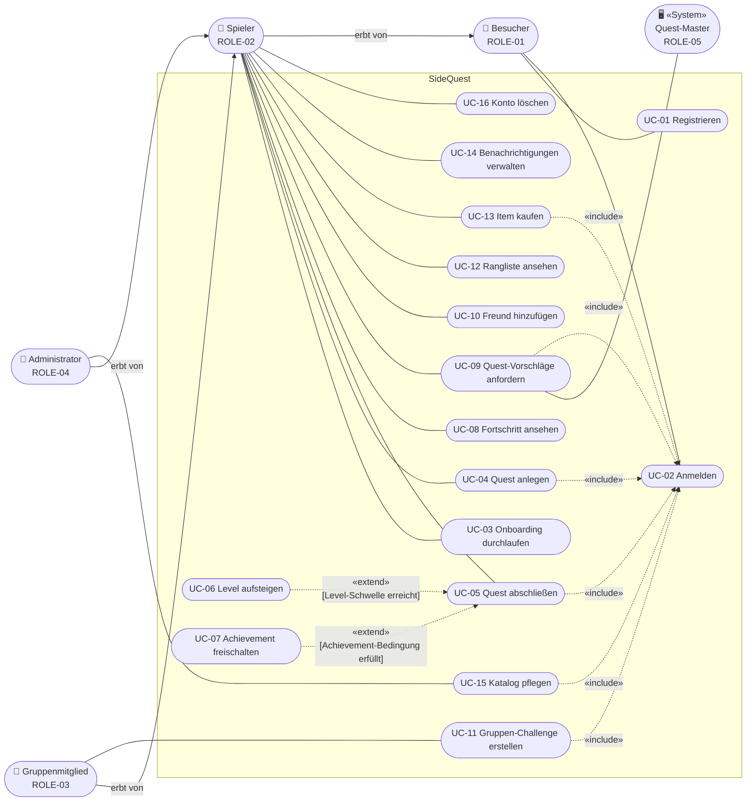
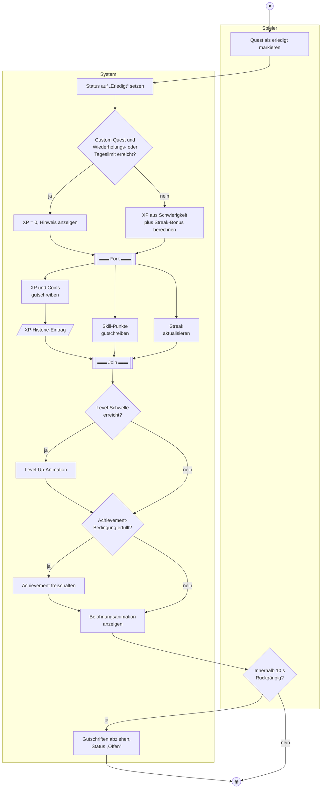
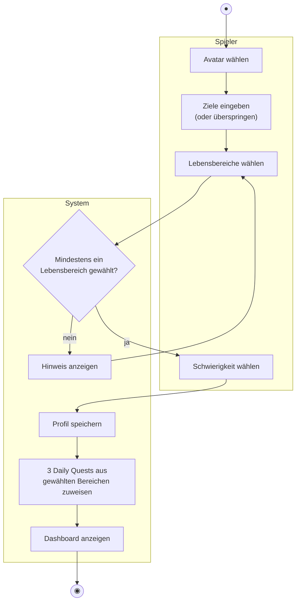

# Use Cases

Notation nach Kapitel 2: Akteure (Personen oder Systeme), Assoziation, Vererbung zwischen Akteuren, «include» (Verhalten wird **immer** eingebunden) und «extend» (**optionales** Verhalten unter einer Bedingung).

## Use-Case-Diagramm

> Hinweis zur Darstellung: Das Diagramm ist in Mermaid gezeichnet, damit GitHub es direkt anzeigt. Akteure stehen als abgerundete Knoten, Use Cases als Ellipsen-Knoten innerhalb der Systemgrenze „SideQuest“; die Pfeilrichtung bei «include» zeigt zum eingebundenen, bei «extend» zum erweiterten Use Case (wie in UML).

## Übersicht

| ID | Use Case | Primärer Akteur | Stories | Anforderungen |
|---|---|---|---|---|
| UC-01 | Registrieren | Besucher | US-01 | REQ-01 – REQ-03 |
| UC-02 | Anmelden | Besucher | US-02 | REQ-04, REQ-05 |
| UC-03 | Onboarding durchlaufen | Spieler | US-03 | REQ-06, REQ-07 |
| UC-04 | Quest anlegen | Spieler | US-05, US-08 | REQ-10 – REQ-12, REQ-19 |
| UC-05 | Quest abschließen | Spieler | US-07, US-11, US-16, US-18, US-20 | REQ-16 – REQ-18, REQ-21, REQ-25 – REQ-27, REQ-35, REQ-38 – REQ-41, REQ-59 |
| UC-06 | Level aufsteigen | Spieler | US-12 | REQ-28 – REQ-30 |
| UC-07 | Achievement freischalten | Spieler | US-21 | REQ-42 – REQ-44 |
| UC-08 | Fortschritt ansehen | Spieler | US-13 – US-15, US-17, US-22, US-23 | REQ-31 – REQ-34, REQ-37, REQ-45, REQ-46 |
| UC-09 | Quest-Vorschläge anfordern | Spieler, Quest-Master | US-10, US-24, US-25 | REQ-24, REQ-47 – REQ-50 |
| UC-10 | Freund hinzufügen | Spieler | US-26 | REQ-51 – REQ-53 |
| UC-11 | Gruppen-Challenge erstellen | Gruppenmitglied | US-28 | REQ-56 – REQ-58 |
| UC-12 | Rangliste ansehen | Spieler | US-27 | REQ-54, REQ-55 |
| UC-13 | Item kaufen | Spieler | US-29 | REQ-60 – REQ-62 |
| UC-14 | Benachrichtigungen verwalten | Spieler | US-30, US-31 | REQ-63 – REQ-65 |
| UC-15 | Katalog pflegen | Administrator | US-32 | REQ-66 |
| UC-16 | Konto löschen | Spieler | US-04 | REQ-08, REQ-09 |

## Use-Case-Vorlagen

### UC-03 Onboarding durchlaufen

| Feld | Inhalt |
|---|---|
| Name / ID | UC-03 Onboarding durchlaufen |
| Akteure | Spieler |
| Auslöser | Spieler meldet sich zum ersten Mal an. |
| Vorbedingungen | Spieler ist registriert und angemeldet; Onboarding wurde noch nicht abgeschlossen. |
| Nachbedingungen | Avatar, Ziele, Lebensbereiche und bevorzugte Schwierigkeit sind gespeichert; der Spieler hat 3 Daily Quests. |
| Hauptszenario | 1. System zeigt die Avatar-Auswahl. 2. Spieler wählt einen Avatar. 3. System fragt nach Zielen. 4. Spieler gibt Ziele als Freitext ein. 5. System zeigt die sieben Lebensbereiche. 6. Spieler wählt 1 bis 7 Lebensbereiche. 7. Spieler wählt die bevorzugte Schwierigkeit. 8. System speichert die Angaben, weist 3 Daily Quests zu und zeigt das Dashboard. |
| Alternativen | 6a. Spieler wählt keinen Lebensbereich: System zeigt einen Hinweis, zurück zu Schritt 5. 4a. Spieler überspringt die Ziele: System speichert leere Ziele und fährt mit Schritt 5 fort. |
| Priorität / Häufigkeit | hoch / einmal je Spieler |
| Bezug | US-03, REQ-06, REQ-07, ACT-02 |

### UC-04 Quest anlegen

| Feld | Inhalt |
|---|---|
| Name / ID | UC-04 Quest anlegen |
| Akteure | Spieler |
| Auslöser | Spieler wählt „Neue Quest“. |
| Vorbedingungen | Spieler ist angemeldet (include UC-02). |
| Nachbedingungen | Die Quest ist mit Status „Offen“ gespeichert und in der Questliste sichtbar. |
| Hauptszenario | 1. System zeigt das Formular mit Quest-Art Custom oder Epic. 2. Spieler gibt Titel, Beschreibung, Lebensbereiche, Schwierigkeit und optional eine Deadline ein. 3. System prüft die Eingaben. 4. System berechnet die XP-Belohnung aus der Schwierigkeit. 5. System speichert die Quest und zeigt sie in der Questliste. |
| Alternativen | 3a. Titel ist kürzer als 3 oder länger als 80 Zeichen oder kein Lebensbereich gewählt: System markiert das Feld, zurück zu Schritt 2. 2a. Spieler wählt Epic Quest: Spieler gibt zusätzlich Laufzeit und 2 bis 20 Checklisten-Punkte ein; nur Epic oder Legendary sind wählbar. |
| Priorität / Häufigkeit | hoch / mehrmals täglich |
| Bezug | US-05, US-08, REQ-10 – REQ-12, REQ-19 |

### UC-05 Quest abschließen

| Feld | Inhalt |
|---|---|
| Name / ID | UC-05 Quest abschließen |
| Akteure | Spieler |
| Auslöser | Spieler wählt bei einer offenen Quest „Erledigt“. |
| Vorbedingungen | Spieler ist angemeldet (include UC-02); die Quest ist offen. |
| Nachbedingungen | Quest-Status ist „Erledigt“; XP, Coins, Skill-Punkte und Streak sind aktualisiert; die Gutschrift steht in der XP-Historie. |
| Hauptszenario | 1. Spieler markiert die Quest als erledigt. 2. System setzt den Status auf „Erledigt“. 3. System prüft die Anti-Farming-Regeln. 4. System berechnet die XP inkl. Streak-Bonus. 5. System schreibt XP, Coins und Skill-Punkte gut und aktualisiert die Streak. 6. System zeigt die Belohnungsanimation. |
| Alternativen | 3a. Custom Quest mit gleichem Titel heute schon dreimal erledigt oder Tageslimit 500 XP erreicht: System schreibt 0 XP gut und weist darauf hin, weiter mit Schritt 5. 5a. Level-Schwelle erreicht: extend UC-06 Level aufsteigen. 5b. Achievement-Bedingung erfüllt: extend UC-07 Achievement freischalten. 6a. Spieler wählt innerhalb von 10 s „Rückgängig“: System setzt den Status zurück und zieht alle Gutschriften ab. |
| Priorität / Häufigkeit | hoch / mehrmals täglich |
| Bezug | US-07, US-11, US-16, US-18, US-20, REQ-16 – REQ-18, REQ-25 – REQ-27, REQ-35, REQ-38 – REQ-41, REQ-59, ACT-01 |

### UC-09 Quest-Vorschläge anfordern

| Feld | Inhalt |
|---|---|
| Name / ID | UC-09 Quest-Vorschläge anfordern |
| Akteure | Spieler (primär), Quest-Master (sekundär, System) |
| Auslöser | Spieler öffnet den Quest-Master und wählt „Vorschläge erzeugen“. |
| Vorbedingungen | Spieler ist angemeldet (include UC-02); der Quest-Katalog enthält Quests zu den gewählten Lebensbereichen. |
| Nachbedingungen | Angenommene Vorschläge sind als offene Quests gespeichert. |
| Hauptszenario | 1. Spieler gibt Ziele ein und wählt Lebensbereiche. 2. System ermittelt die Erfolgsquote der letzten 7 Tage. 3. Quest-Master erzeugt 3 Daily-, 2 Weekly- und 1 Epic-Vorschlag passend zu Lebensbereichen und Schwierigkeit. 4. System zeigt die Vorschläge. 5. Spieler nimmt einzelne Vorschläge an. 6. System speichert sie als offene Quests. |
| Alternativen | 2a. Erfolgsquote unter 50 % bzw. über 90 %: Quest-Master senkt bzw. erhöht die Schwierigkeit um einen Grad. 3a. Zu wenige passende Katalog-Quests: System zeigt so viele Vorschläge wie vorhanden und einen Hinweis. 5a. Spieler lehnt alle ab: keine Änderung. |
| Priorität / Häufigkeit | mittel / einige Male pro Woche |
| Bezug | US-24, US-25, REQ-47 – REQ-50 |

### UC-11 Gruppen-Challenge erstellen

| Feld | Inhalt |
|---|---|
| Name / ID | UC-11 Gruppen-Challenge erstellen |
| Akteure | Gruppenmitglied (Ersteller), eingeladene Freunde |
| Auslöser | Spieler wählt „Neue Gruppen-Challenge“. |
| Vorbedingungen | Spieler ist angemeldet (include UC-02) und hat mindestens einen Freund. |
| Nachbedingungen | Challenge ist angelegt; eingeladene Freunde sind benachrichtigt; nach Ablauf ist sie erfüllt oder nicht erfüllt. |
| Hauptszenario | 1. Spieler gibt Titel, Ziel (Anzahl Quests, optional Lebensbereich) und Laufzeit ein. 2. Spieler wählt 1 bis 9 Freunde aus. 3. System legt die Challenge an und benachrichtigt die Freunde. 4. Teilnehmer erledigen Quests; System zählt passende Quests zum gemeinsamen Fortschritt. 5. Ziel wird innerhalb der Laufzeit erreicht. 6. System schreibt jedem Teilnehmer 100 XP gut. |
| Alternativen | 1a. Laufzeit außerhalb 1 bis 14 Tage: System zeigt einen Hinweis, zurück zu Schritt 1. 5a. Laufzeit endet ohne Zielerreichung: System markiert die Challenge als nicht erfüllt, keine XP. |
| Priorität / Häufigkeit | niedrig / wenige Male pro Monat |
| Bezug | US-28, REQ-56 – REQ-58 |

## Aktivitätsdiagramme

### ACT-01 Quest abschließen (UC-05)

### ACT-02 Onboarding durchlaufen (UC-03)

