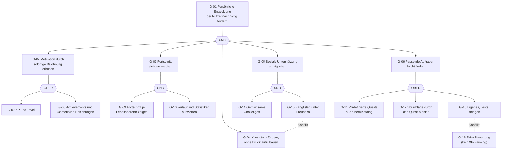

# Ziele (Zielbaum)

Ziele begründen die Anforderungen (Pre-Traceability). Jedes Epic verweist auf mindestens ein Ziel. Notation nach Kapitel 2: UND-Zerlegung (alle Teilziele nötig), ODER-Zerlegung (eines der Teilziele genügt), Konflikt (Ziele behindern sich gegenseitig).

## Zielbeschreibungen

| ID | Ziel | Zerlegung / Beziehung |
|---|---|---|
| G-01 | Persönliche Entwicklung der Nutzer nachhaltig fördern | Oberziel, UND-Zerlegung in G-02 bis G-06 |
| G-02 | Motivation durch sofortige Belohnung erhöhen | ODER-Zerlegung in G-07, G-08 |
| G-03 | Fortschritt sichtbar machen | UND-Zerlegung in G-09, G-10 |
| G-04 | Konsistenz fördern, ohne Druck aufzubauen | Konflikt mit G-15 |
| G-05 | Soziale Unterstützung ermöglichen | UND-Zerlegung in G-14, G-15 |
| G-06 | Passende Aufgaben leicht finden | ODER-Zerlegung in G-11, G-12, G-13 |
| G-07 | XP und Level | Teilziel von G-02 |
| G-08 | Achievements und kosmetische Belohnungen | Teilziel von G-02 |
| G-09 | Fortschritt je Lebensbereich zeigen | Teilziel von G-03 |
| G-10 | Verlauf und Statistiken auswerten | Teilziel von G-03 |
| G-11 | Vordefinierte Quests aus einem Katalog | Teilziel von G-06 |
| G-12 | Vorschläge durch den Quest-Master | Teilziel von G-06 |
| G-13 | Eigene Quests anlegen | Teilziel von G-06, Konflikt mit G-16 |
| G-14 | Gemeinsame Challenges | Teilziel von G-05 |
| G-15 | Ranglisten unter Freunden | Teilziel von G-05, Konflikt mit G-04 |
| G-16 | Faire Bewertung (kein XP-Farming) | Querschnittsziel, Konflikt mit G-13 |

## Zielkonflikte und Auflösung

| Konflikt | Beschreibung | Konflikttyp | Auflösung |
|---|---|---|---|
| G-15 ⟂ G-04 | Ranglisten erzeugen Wettbewerb und damit Druck; G-04 will Konsistenz ohne Druck. | Wertkonflikt | Kreative Lösung: Ranglisten nur unter Freunden, wöchentlich zurückgesetzt, Teilnahme abschaltbar (US-27, REQ-55). |
| G-13 ⟂ G-16 | Eigene Quests mit frei wählbarer Schwierigkeit erlauben es, beliebig viele XP zu sammeln. | Interessenkonflikt | Verhandlung: Eigene Quests bleiben möglich, aber mit Tageslimit für XP aus Wiederholungen (REQ-12, REQ-26, REQ-27). |
